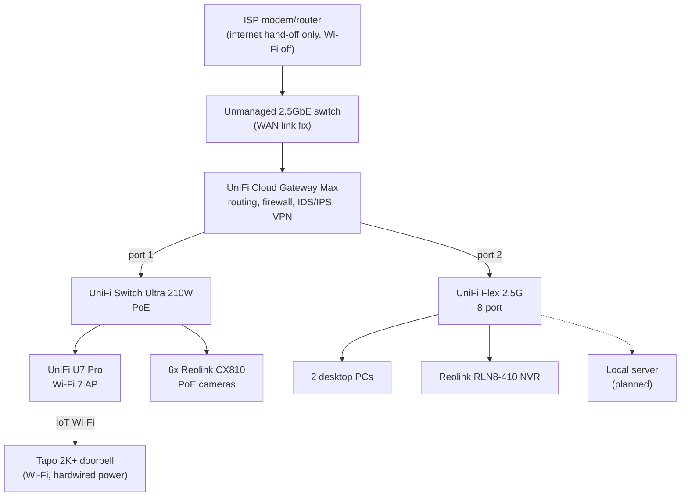

# Project H: Homelab based on efficient Networking & Security

A personal project, built for fun, to challenge myself, and because I can.

A segmented, local-first home network for a single-family bungalow. The household gets Wi-Fi/Internet that just works, while IoT devices, cameras and guests are isolated from personal devices and video never leaves the house. 

## Design goals

- **Zero effort for the household.** No VPN, no settings, no procedures to remember. If a hobby component goes down, the internet keeps working.
- **Segment untrusted devices.** IoT, cameras and guests each get their own VLAN and firewall zone.
- **Local-first video.** Cameras record to a local NVR and are blocked from the internet. Remote viewing goes only through a VPN.
- **Minimal exposure.** UPnP is off and there are no port forwards for devices. The only inbound path is the WireGuard VPN.

## Topology

Both LAN switches uplink directly to the gateway rather than daisy-chaining. The PoE switch is reserved for the access point and cameras. The 2.5GbE switch carries the NVR, PCs and the future local server, with ports left over for whatever gets added later.

The little unmanaged switch between the modem and gateway is there on purpose. See [WAN speed troubleshooting](wan-speed-troubleshooting.md).

## Hardware

| Role | Device |
| --- | --- |
| Gateway / firewall | UniFi Cloud Gateway Max |
| WAN link switch | Unmanaged 2.5GbE switch |
| 2.5GbE switch | UniFi Flex 2.5G (8-port) |
| PoE switch | UniFi Switch Ultra 210W |
| Wi-Fi | UniFi U7 Pro (Wi-Fi 7) |
| NVR | Reolink RLN8-410 |
| Cameras | 6x Reolink CX810 (PoE) |
| Doorbell | Tplink Tapo 2K+ (Wi-Fi, hardwired 24/7 power) |
| Rack | Custom built 10-inch wall mounted mini rack, custom 3D-printed mounts, custom local server housing |
| Cabling | Hand-terminated Cat6 |

## Key decisions

- **Reolink for cameras:** local recording, no mandatory subscription, 24/7 recording, ONVIF/RTSP support and an app the household can use without help.
- **No whole-network VPN:** it would add privacy at a real usability cost for the household. Security comes from gateway firewall rules and segmentation instead.
- **Doorbell on the IoT VLAN, not Cameras:** it isn't recorded by the NVR and needs internet for its app, so it doesn't belong in the internet-blocked camera zone.
- **NVR handles all storage:** no separate server for video, which means fewer moving parts.

## Docs

- [Network design](network-design.md): VLANs, firewall zones, Wi-Fi and RF plan
- [WAN speed troubleshooting](wan-speed-troubleshooting.md): diagnosing a link-negotiation fault between the ISP modem and the gateway

## Status

- Network, firewall, Wi-Fi, IDS/IPS and VPN: done
- Cameras and doorbell: configured, waiting on physical install
- Local server: planned, will get its own repo when it exists
